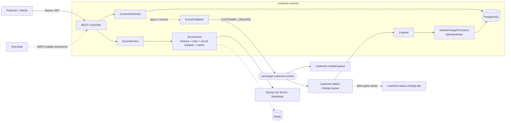

# customer-service

Microsserviço de gerenciamento de clientes — **Java 25 · Spring Boot 3.5 · Maven · PostgreSQL · RabbitMQ · Redis · OAuth2/JWT (Keycloak) · Docker/Kubernetes**.

## Arquitetura



| Camada | Decisão |
|---|---|
| API | REST, validação (Bean Validation), erros em RFC 9457 (`ProblemDetail`), paginação |
| Segurança | Resource Server stateless, JWT validado via JWKS. `realm_access.roles` → `ROLE_USER` / `ROLE_ADMIN` |
| Persistência | Spring Data JPA + Flyway (`ddl-auto=validate`), CPF com `UNIQUE`, `@Version` (lock otimista) |
| Score externo | `RestClient` com timeouts, Retry (3x, backoff), Circuit Breaker (Resilience4j), cache Redis (10 min) |
| Mensageria | RabbitMQ: exchange `customer.events`, DLX/DLQ, retry no consumidor, consumidor idempotente |
| Concorrência | Threads virtuais do Java (`spring.threads.virtual.enabled`) |
| Observabilidade | Actuator (probes), Prometheus, métricas de negócio, export opcional ao Dynatrace |

## Requisitos
Docker + Docker Compose. Para rodar fora de container: JDK 25 e Maven 3.9+. **Os testes de integração precisam de Docker** (Testcontainers).

## Como iniciar
```bash
docker compose up --build          # sobe tudo: app, Postgres, RabbitMQ, Redis, Keycloak e mock do Score
```
Só as dependências (app local com `mvn spring-boot:run`):
```bash
docker compose up -d postgres rabbitmq redis keycloak score-mock
mvn spring-boot:run
```
| Serviço | URL |
|---|---|
| API | http://localhost:8080 |
| Keycloak | http://localhost:8180 (admin/admin) |
| RabbitMQ UI | http://localhost:15672 (guest/guest) |
| Mock do Score | http://localhost:8089 |

## Access Token
Usuários do realm `customers` (importado automaticamente): `user/user123` (**USER**) e `admin/admin123` (**ADMIN**).
```bash
TOKEN=$(curl -s -X POST http://localhost:8180/realms/customers/protocol/openid-connect/token \
  -d grant_type=password -d client_id=customers-api -d username=admin -d password=admin123 | jq -r .access_token)
```
No Postman: *Authorization → Bearer Token* com o valor obtido. O token dura 1h (ambiente de dev).

## Endpoints
| Método | Rota | Perfil | Respostas |
|---|---|---|---|
| POST | `/customers` | ADMIN | 201, 400, 409 (CPF duplicado) |
| PUT | `/customers/{id}` | ADMIN | 200, 400, 404, 409 |
| DELETE | `/customers/{id}` | ADMIN | 204, 404 |
| GET | `/customers/{id}` | USER, ADMIN | 200, 404 |
| GET | `/customers?status=ACTIVE&page=0&size=20` | USER, ADMIN | 200, 400 |
| GET | `/customers/search?name=joao` | USER, ADMIN | 200 |
| GET | `/customers/{id}/score` | USER, ADMIN | 200, 404, 503 (+`Retry-After`) |
| GET | `/actuator/health`, `/actuator/prometheus` | público | — |

Sem token → **401**; perfil sem permissão → **403**.

```bash
curl -X POST localhost:8080/customers -H "Authorization: Bearer $TOKEN" -H 'Content-Type: application/json' \
  -d '{"name":"João da Silva","cpf":"12345678901","email":"joao@email.com"}'
curl -H "Authorization: Bearer $TOKEN" localhost:8080/customers/1/score      # {"cpf":"12345678901","score":750,"classification":"LOW_RISK"}
curl -H "Authorization: Bearer $TOKEN" 'localhost:8080/customers?status=ACTIVE'
```
CPFs do mock de Score: `12345678901` → 200 · `00000000001` → 404 · `99999999999` → 500 · `88888888888` → atraso de 10 s (timeout) · demais com 11 dígitos → 200 genérico.

## Integração com RabbitMQ
* **Publicação** — após o *commit* do cadastro, publica `CUSTOMER_CREATED` (exchange `customer.events`, routing key `customer.created`, fila `customer.created.queue`):
  `{"eventId":"<uuid>","eventType":"CUSTOMER_CREATED","customerId":123,"createdAt":"2026-08-11T15:30:00Z"}`
* **Consumo** — fila `customer.status-change.queue` (routing key `customer.status.change`):
  `{"eventId":"<uuid>","eventType":"CUSTOMER_STATUS_CHANGE","customerId":123,"status":"INACTIVE"}`
  Para testar: na UI do RabbitMQ, *Exchanges → customer.events → Publish message* com a routing key acima.
* **Mensagem duplicada** — o `eventId` é gravado em `processed_events` (PK) na **mesma transação** da alteração de status; reentregas são ignoradas, inclusive concorrentes.
* **Falha no processamento** — 3 tentativas com backoff; esgotadas (ou mensagem inválida / cliente inexistente) a mensagem vai para `customer.status-change.dlq`.
* **RabbitMQ fora do ar na publicação** — o cadastro não falha; o erro é logado e contado em `customer.events.published{result="failed"}` (alertar nessa métrica). Evolução recomendada: *transactional outbox*.

## Testes
```bash
mvn test       # unitários (JUnit 5 + Mockito)
mvn verify     # unitários + integração (Testcontainers: PostgreSQL e RabbitMQ; WireMock para o Score)
```
Integração cobre: CRUD, validação, 401/403, busca/filtro, score (200, 404, 500 com retry, timeout, circuit breaker aberto, cache), evento publicado, consumo, duplicidade e DLQ.

## Configuração (variáveis de ambiente)
`DB_URL`, `DB_USER`, `DB_PASSWORD`, `DB_POOL_SIZE`, `RABBIT_HOST`, `RABBIT_USER`, `RABBIT_PASSWORD`, `REDIS_HOST`, `JWT_JWK_SET_URI`, `SCORE_BASE_URL`, `SCORE_CONNECT_TIMEOUT`, `SCORE_READ_TIMEOUT`, `DT_METRICS_ENABLED`, `DT_METRICS_URI`, `DT_API_TOKEN`. Valores padrão em `application.yml`.
> Em produção defina `spring.security.oauth2.resourceserver.jwt.issuer-uri` para validar também o `iss` (aqui só assinatura/validade, porque o `iss` difere entre `localhost` e a rede do Docker).

## DevOps
* **Docker** — build multi-stage, usuário não-root. **Kubernetes** — `k8s/customer-service.yaml` (probes, HPA, PDB, graceful shutdown, limites).
* **CI** — `.github/workflows/ci.yml` (`mvn verify` + build da imagem).
* **Performance** — `perf/load-test.js` (k6) e `docs/PERFORMANCE_TESTING.md`. **Causa raiz** — `docs/TROUBLESHOOTING.md`.
* **Dynatrace** — em Kubernetes via Dynatrace Operator (OneAgent injeta traces/APM), ou `DT_METRICS_ENABLED=true` com `DT_METRICS_URI`/`DT_API_TOKEN` para exportar as métricas do Micrometer.

## Segurança e escalabilidade
Aplicação stateless (escala horizontalmente via HPA), JWT sem sessão, `denyAll` por padrão, segredos fora da imagem, container não-root, sem PII (CPF) em mensagens de erro, timeouts em todas as chamadas externas, cache e circuit breaker para proteger o provedor, consumidores concorrentes na fila para escalar o processamento.

## Próximos passos
Transactional outbox · Kafka para streaming de eventos (se o requisito mudar) · mascarar CPF nos logs/respostas conforme LGPD · rate limiting no gateway · Helm chart · `issuer-uri` + mTLS entre serviços.
